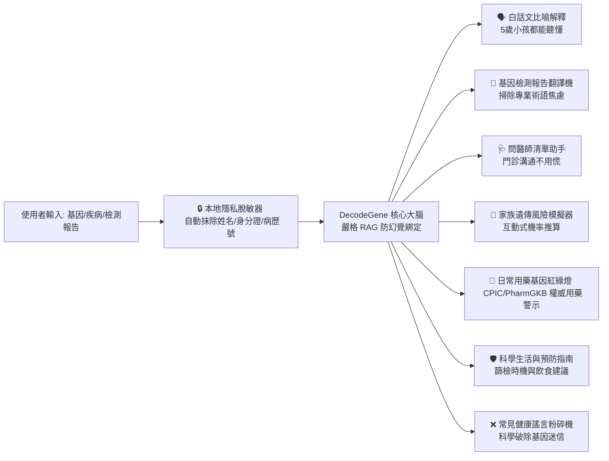

# 🧬 DecodeGene (解碼基因)
### 面向大眾與科研人員的開源基因-健康知識圖譜與智慧科普平台
> An Open-Source, Consumer-Friendly Gene-Disease Knowledge Graph & AI Health Intelligence Platform (Traditional Chinese `繁體中文` & `English` Bilingual UI)

[](LICENSE)
[](https://python.org)
[](https://fastapi.tiangolo.com)
[](https://vitejs.dev)
[](https://deepseek.com)

---

## 🌟 專案使命：讓複雜的基因科學「人人都看得懂」 (Our Mission)

傳統的生物醫學資料庫（如 ClinVar, OMIM, NCBI）充滿了晦澀的專業術語（如 *Heterozygous frameshift*, *Incomplete penetrance*, *Haploinsufficiency*），一般大眾拿到基因檢測報告或看到家族病史時，往往感到無助與焦慮。

**DecodeGene** 致力於打破生物醫學知識壁壘，預設採用**繁體中文 (`zh-TW`)** 並內建右上角 **「繁體中文 ⇄ English」即時雙語切換開關**，將全球權威的科學資料透過 **生動形象的比喻、互動式動態圖譜、白話文基因報告翻譯、生活預防指南** 以及 **DeepSeek AI 智慧醫師助手**，轉化為一般人一目了然的健康常識。

---

## ✨ 核心大眾化特色功能 (Consumer-Centric Features)



### 1. 🗣️ 「白話文比喻」機制解析 (Visual Metaphor Engine)
- **拒絕天書**: 不說「同源重組 DNA 雙股斷裂修復缺陷」，而是解釋「BRCA1 就像細胞裡的『DNA 汽車維修工』，工人生病罷工了，車子出故障（癌變）的機率就會上升」。
- **雙語/雙模式切換**: 支援在 **【🌱 小白科普模式】** 與 **【🔬 專業科研模式】**（展示 Ensembl ID、Entrez ID、HPO 表型、Open Targets 評分與標靶藥管線），以及 **【繁體中文 ⇄ English】** 之間一秒自由切換。

### 2. 📄 基因檢測報告「白話文翻譯機」 (Report Decoder)
- 支援複製或貼上商業基因檢測或醫院檢測中的突變位點（如 `BRCA1 c.5266dupC`, `APOE ε4`, `ALDH2 rs671`）。
- 自動提取關鍵位點，給出客觀、冷靜的風險說明與科學預防步驟。

### 3. 🩺 「就醫提問清單產生器」 (Doctor Checklist Generator)
- 系統根據使用者關注的基因/疾病，一鍵產生 **《門診就醫提問清單》**（如：「我需要多久做一次乳房磁振造影？」、「我的直系親屬需要做篩檢嗎？」），支援一鍵複製到手機或列印。

### 4. 🧬 家族遺傳與機率模擬器 (Family Inheritance Visualizer)
- 直觀展示體染色體顯性、隱性及 X 連鎖遺傳。使用者選擇父母狀態即可直觀看到「如果父母攜帶該突變，子女遺傳機率是多少」，避免盲目恐慌。

### 5. 💊 日常用藥基因紅綠燈與體質百科 (Pharmacogenomics / PGx Traffic Light)
- 深度整合 **CPIC** 與 **PharmGKB** 權威臨床指南，為一般人最關心的日常用藥安全與體質基因提供 **🔴禁用 / 🟡慎用 / 🟢常規** 紅綠燈指引：
  - **`ALDH2` (酒精代謝與急救藥警示)**：東亞人群 30%~47% 攜帶 `rs671` 變異，不僅喝酒臉紅易致食道癌，而且**心絞痛急救藥「硝酸甘油（硝化甘油）」需依賴 ALDH2 轉化才能起效，攜帶者舌下含服可能無效甚至延誤急救**！
  - **`G6PD` (蠶豆症用藥與飲食安全)**：紅血球缺乏防氧化保護，嚴禁食用新鮮蠶豆，禁用磺胺類抗生素、伯氨喹、樟腦丸及部分退燒藥，防止急性溶血。
  - **`MTHFR` (葉酸代謝與 H 型高血壓)**：`C677T (rs1801133)` 突變導致普通葉酸轉化效率下降，指導備孕女性精準補充「5-甲基四氫葉酸（活性葉酸）」，指導中老年人監測同半胱胺酸（Hcy）預防腦中風。

### 6. 🛡️ 行動指南與預防篩檢建議 (Actionable Prevention Advice)
- 明確區分「遺傳風險因子」與「必然致病」，提供權威指南推薦的早期篩檢年齡、常規體檢項目、日常飲食與生活型態建議。

### 7. ❌ 基因健康「謠言粉碎機” (Myth Busters)
- 權威解答：「攜帶突變一定會得癌症嗎？」、「喝酒臉紅代表血液循環好嗎？」、「蠶豆症長大就會好嗎？」，破除偽科學迷信。

---

## 🛡️ 隱私脫敏與醫療級防 AI 幻覺安全護欄 (Privacy & Anti-Hallucination Guardrails)

1. **🔒 隱私優先與本地 PII 自動脫敏 (Local PII Scrubber)**:
   - 在任何基因報告文本離開本地或發送至雲端大模型前，系統透過 `backend/app/core/privacy.py` 本地正規表示式與規則引擎，**自動抹除姓名、身分證號、手機號、病歷號、住院號及醫院名稱**，僅提取純基因符號與 HGVS 變異位點（如 `BRCA1 c.5266dupC`），伺服器預設**零留存 (Zero-Retention)**。
2. **🎯 醫療級防 AI 幻覺護欄 (Anti-Hallucination & JEV Verification)**:
   - **嚴格 RAG 事實綁定**: AI 嚴禁脫離本地 ClinVar / Open Targets / CPIC / HPO 權威資料庫證據自由編造突變致病性、藥物劑量或篩檢年齡。
   - **未知位點熔斷機制**: 若權威資料庫未收錄某生僻位點，系統強制觸發熔斷並返回*「當前權威資料庫未收錄該位點或基因，請攜帶原始報告諮詢臨床遺傳醫師」*，絕不猜測或編造醫學結論。
   - **事實一致性自動審計 (Audit Pipeline)**: 對輸出內容自動校驗 Ensembl/MONDO/HPO 識別碼與證據等級一致性。

---

## 🏗️ 目錄結構 (Project Structure)

```text
DecodeGene/
├── data/                       # 離線資料快取與資料字典
│   ├── sample/                 # 大眾化精選離線資料集 (繁體中文 + 專業雙模)
│   └── processed/              # DuckDB / SQLite 高速知識庫
├── pipeline/                   # 資料擷取與清洗管道
│   ├── apis/                   # Open Targets, ClinVar, CPIC 等 API 轉接器
│   └── parsers/                # 資料標準化與通俗化比喻標註
├── backend/                    # FastAPI 後端服務
│   ├── app/
│   │   ├── core/               # 設定、資料集載入、本地 PII 隱私脫敏器
│   │   ├── models/             # Pydantic v2 雙模嚴格 Schema
│   │   ├── services/           # 遺傳機率計算器、RAG 通俗化推理引擎、搜尋與清單服務
│   │   └── main.py
├── frontend/                   # 現代化 Web 前端 (React + Vite + 繁體中文/English 雙語切換)
│   ├── src/
│   │   ├── components/         # 比喻卡片、PGx 紅綠燈、家族模擬器、就醫清單、報告解碼器
│   │   ├── i18n/               # 繁體中文 (zh-TW) 與英文 (en) 完整雙語詞典與基因翻譯
│   │   └── services/           # API 客戶端與瀏覽器本地離線引擎
│   └── package.json
├── scripts/                    # 結構與生物醫學識別碼確定性校驗器
├── docs/                       # 企劃書、AI 指令集與科普設計指南
└── README.md
```

---

## 🚀 快速開始與部署 (Quick Start & Deployment)

> **架構交付說明**：目前專案已內建完整雙模資料集 (`data/sample/demo_associations.json`)、雙模 Pydantic 資料模型 (`backend/app/models/schema.py`)、本地 PII 隱私脫敏器 (`backend/app/core/privacy.py`)、遺傳機率計算器 (`backend/app/services/inheritance.py`)、防幻覺 DeepSeek 推理服務 (`backend/app/services/ai_reasoning.py`)、完整 REST API (`backend/app/main.py`)、資料擷取管道 (`pipeline/`)、React + Vite 雙模雙語前端（含零建置 `frontend/standalone.html` 離線版）、自動化 pytest 測試套件、Fail-Closed 資料集校驗器 (`scripts/validate_schema.py`) 以及容器化編排檔案 (`Dockerfile`, `docker-compose.yml`)。

### 步驟 0：執行內建資料集與雙模 Schema 校驗（開箱即用，Fail-Closed）
```bash
python -B scripts/validate_schema.py
python -m pipeline.run_pipeline --verify
```

### 步驟 1：啟動後端（開箱即用）
```bash
pip install -r backend/requirements.txt
uvicorn backend.app.main:app --reload
# API 文件：http://127.0.0.1:8000/docs
```

### 步驟 2：啟動 React + Vite 前端（支援右上角 `繁體中文 ⇄ English` 切換）
```bash
cd frontend
npm install
npm run dev
# 開啟 http://127.0.0.1:5173
```
Vite 已設定 `/api` 代理到 `http://127.0.0.1:8000`；若後端未啟動，前端會自動回退到內建 7 基因資料集與瀏覽器本地脫敏/遺傳計算引擎。

### 一步啟動（可選，自動拉起前後端）
```bash
python run_dev.py
```

### 步驟 3：零建置離線單頁（無需 npm / 無需後端）
直接用瀏覽器開啟 `frontend/standalone.html`（雙擊即可）。它內嵌 7 基因繁體中文/英文資料集與本地 JS 脫敏/遺傳計算邏輯，完全離線可用。

### 步驟 4：執行自動化測試
```bash
pytest
```
測試涵蓋：7 基因 Pydantic 校驗、PII 100% 脫敏、AD/AR/XD/XR 機率、全部 REST 端點與未知基因熔斷。

### 方式 1：🐳 Docker 一鍵啟動全端服務（內建 `Dockerfile` & `docker-compose.yml`）
在專案根目錄啟動 Docker Desktop 後執行：
```bash
docker compose up --build
```
建置階段會自動執行 `python -B scripts/validate_schema.py` Fail-Closed 校驗，並建置 React 靜態資源。啟動後：
- 前端 UI：`http://127.0.0.1:8000/app`
- API 文件：`http://127.0.0.1:8000/docs`
- 健康檢查：`http://127.0.0.1:8000/health`

### 方式 2：🌐 GitHub Pages / Vercel / Netlify 純靜態線上預覽 (`VITE_STATIC_DEMO=true`)
無需後端伺服器即可將互動式雙語前端直接免費部署到靜態託管平台：
```bash
cd frontend
npm run build:static
# 將產生的 frontend/dist 目錄直接發佈至 GitHub Pages / Vercel / Netlify
```

---

## ⚠️ 免責聲明與倫理準則 (Medical & Ethics Disclaimer)
DecodeGene 僅供**科學普及、學術研究與健康常識參考**，不能替代專業醫師、臨床遺傳諮詢師的臨床診斷和醫療決策。涉及任何實際醫療、用藥或檢測決策，請務必諮詢具有執業資質的專業醫事人員。
