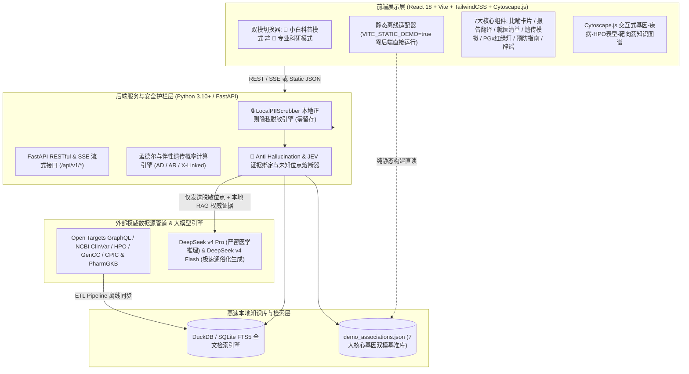

# 📋 DecodeGene 开源项目综合规划与技术架构方案书
### 面向大众科普与专业研究的基因健康智能知识平台方案 (Comprehensive Specification)

---

## 1. 项目定位与受众画像 (Product Positioning & Target Audience)

### 1.1 项目使命
让复杂的基因组学与遗传医学走出象牙塔，成为**普通大众人人都看得懂、用得上、能指导健康生活的公开透明知识库与 AI 智能助手**。

### 1.2 目标受众画像 (Target Audience Personas)
1. **拿到基因检测报告的普通消费者**: 做了 23andMe、微基因或医院基因检测，看到专业术语感到迷茫或恐慌，急需客观、通俗的解释。
2. **有家族病史/关注健康的患者家属**: 想知道父母或自己携带某个突变，子女遗传概率多大？平时该如何筛查与预防？
3. **即将去医院就诊的患者**: 不知道怎么向医生描述遗传风险，需要一份《就诊提问清单》。
4. **科普爱好者与中学生/大学生**: 想要直观、有趣地探索“基因如何影响生命与疾病”的动态图谱。
5. **临床医生与科研人员**: 可以一键切换到【专业模式】，查看原汁原味的 ClinVar 证据、PubMed 引用及 Open Targets 评分。

---

## 2. 大众化核心功能模块（7大模块） (Seven Core Consumer-Centric Modules)

```mermaid
graph TD
    subgraph UI Layer [用户交互层 - 双模极简友好设计]
        U1[🌱 小白科普模式 ⇄ 🔬 专业科研模式 一键切换]
        U2[基因检测报告快速粘贴/本地脱敏解析器]
        U3[自然语言健康问答与多维搜索框]
    end

    subgraph Privacy & Guardrail Layer [安全与防幻觉护栏层]
        S1[🔒 Local PII Scrubber 本地隐私正则脱敏器]
        S2[🎯 Anti-Hallucination & JEV 事实绑定与未知位点熔断]
    end

    subgraph Core Consumer Modules [大众化七大核心模块]
        M1[🗣️ 1. 生活化比喻引擎 <br/> Visual Metaphor Engine]
        M2[📄 2. 基因检测报告白话文翻译机 <br/> Report Decoder]
        M3[🩺 3. 门诊就医提问清单生成器 <br/> Doctor Checklist]
        M4[🧬 4. 家族遗传与下一代风险模拟器 <br/> Family Inheritance Simulator]
        M5[💊 5. 日常用药基因红绿灯与体质百科 <br/> PGx Traffic Light]
        M6[🛡️ 6. 科学预防与生活指南 <br/> Actionable Prevention]
        M7[❌ 7. 基因谣言粉碎机 <br/> Myth Busters]
    end

    subgraph DeepSeek AI Engine [DeepSeek v4 AI 智能大脑]
        AI1[DeepSeek v4 Pro: 严密因果推理与医学逻辑审查]
        AI2[DeepSeek v4 Flash: 极速通俗化改写与情绪安抚语气生成]
    end

    subgraph Data Foundation [底层权威数据基座]
        DB[(ClinVar + OpenTargets + HPO + GenCC + CPIC/PharmGKB)]
    end

    UI Layer --> Privacy & Guardrail Layer
    Privacy & Guardrail Layer --> Core Consumer Modules
    Core Consumer Modules --> DeepSeek AI Engine
    DeepSeek AI Engine --> Data Foundation
```

### 2.1 🗣️ 生活化比喻引擎 (Visual Metaphor Engine)
普通人无法理解“染色体双链断裂同源重组修复缺陷”，系统将其精准映射为日常生活模型：
- **`BRCA1`**: 细胞里的【**DNA 汽车维修工程师**】——当 DNA 零件磨损断裂时负责精准修复；维修工罢工后，故障车继续上路就容易发生重大事故（乳腺癌/卵巢癌）。
- **`TP53`**: 细胞里的【**紧急制动刹车片 / 基因组保安**】——一旦发现细胞 DNA 严重受损变坏，立刻踩下刹车暂停分裂或命令异常细胞自毁；刹车失灵则导致多器官早发肿瘤（李-佛美尼综合征）。
- **`APOE`**: 大脑里的【**垃圾清运卡车**】——`ε4` 型号清运卡车效率偏慢，导致脑内 β-淀粉样蛋白垃圾容易沉积，增加晚年阿尔茨海默病风险。
- **`EGFR`**: 细胞表面的【**生长油门踏板**】——敏感突变导致油门卡死在“踩到底”状态，而靶向药（奥希替尼/吉非替尼）就是精准卡住油门的“定制刹车钥匙”。
- **`ALDH2`**: 肝脏里的【**酒精解毒流水线二号工人**】——一号工人（ADH1B）把酒精变成剧毒乙醛，二号工人（ALDH2）负责把乙醛变成无害乙酸；二号工人罢工会导致乙醛堆积脸红，且无法正常激活心绞痛急救药硝酸甘油。
- **`G6PD`**: 红细胞的【**防氧化防弹衣**】——缺乏防弹衣时，红细胞遇到新鲜蚕豆、樟脑丸或磺胺类药物等强氧化剂，就会像气球一样成批破裂（急性溶血）。
- **`MTHFR`**: 人体叶酸加工厂的【**转化机器**】——`C677T` 变异导致机器转速下降，普通叶酸难以转化为人体可直接利用的“5-甲基四氢叶酸（活性叶酸）”，引起血同型半胱氨酸（Hcy）升高。

---

### 2.2 📄 基因检测报告白话文翻译机 (Report Decoder)
用户输入示例：
> “患者姓名：张伟，身份证：31010419900101xxxx，报告结果：**BRCA1 c.5266dupC (p.Gln1756Profs) 杂合突变，ClinVar 提示 Pathogenic**。我是不是马上会得乳腺癌？”

**系统处理与输出规范**:
1. **本地隐私脱敏 (Local PII Scrubbing)**: 前端与本地引擎毫秒级抹除“张伟”、“31010419900101xxxx”等个人信息，仅提取 `BRCA1 c.5266dupC (Heterozygous, Pathogenic)`。
2. **消除恐慌 (Reassurance)**: “首先请保持冷静。携带突变并不等于已经患癌，它代表的是一种‘终身患病风险升高’（遗传易感性），完全可以通过早期筛查和科学管理来有效预防。”
3. **术语白话翻译**: 解释什么是“杂合突变”（父母各传一份基因拷贝，其中一份发生变异）、“致病性变异 (Pathogenic)”（已被国际医学界证实会显著提升疾病易感风险）。
4. **数字量化对比**: 给出直观对比（普通女性终身乳腺癌风险约 12%，携带该突变人群约 60%~70%）。
5. **行动指引**: 给出下一步行动路线（挂乳腺外科/临床遗传门诊、推荐 25~30 岁起定期做乳腺增强 MRI）。

---

### 2.3 🩺 门诊就医提问清单生成器 (Doctor Checklist)
许多人面对医生时由于紧张或医学知识匮乏，不知道问什么。系统支持**一键生成可打印/手机可截图的《专属门诊提问卡》**：

```text
📋 【DecodeGene 专属就医提问卡】（可直接截图或给医生看）
关注基因/疾病: BRCA1 突变 / 遗传性乳腺癌-卵巢癌综合征 | 推荐科室: 乳腺外科 / 肿瘤科 / 临床遗传门诊

1. 医生您好，我的基因报告提示 BRCA1 突变，几岁开始建议我做乳腺增强磁共振 (MRI)？
2. 除了乳腺，对于卵巢和输卵管的健康，您建议我定期做什么筛查（如 CA125、经阴道超声）？
3. 我的直系亲属（母亲、姐妹、子女）是否有必要做同位点的基因筛查？
4. 如果未来有生育计划，目前是否有三代试管 (PGT-M) 阻断突变遗传的技术？
```

---

### 2.4 🧬 家族遗传与下一代风险模拟器 (Family Inheritance Simulator)
- **图形化交互家族树 (Interactive Pedigree Tree)**:
  - 支持选择遗传模式：**常染色体显性遗传 (AD，如 BRCA1/TP53)**、**常染色体隐性遗传 (AR)**、**X 连锁不完全显性/隐性遗传 (X-linked，如 G6PD 蚕豆病)**。
  - 用户勾选父母携带/患病状态，系统实时计算并展示：息子/息女各自的患病概率、无症状携带概率，以及三代试管（PGT-M）与产前诊断科普简介。

---

### 2.5 💊 【新增】日常用药基因红绿灯与体质百科 (Pharmacogenomics / PGx Traffic Light)
普通大众日常最关心“我喝酒为什么脸红？”、“家里宝宝有蚕豆病哪些药绝对不能碰？”、“备孕叶酸怎么补才有效？”。本模块深度整合 **CPIC (Clinical Pharmacogenetics Implementation Consortium)** 与 **PharmGKB** 权威指南，提供直观的 **🔴红灯（禁用/无效高危） / 🟡黄灯（慎用/调整剂量） / 🟢绿灯（常规使用）** 决策卡片：
- **酒精代谢与心血管急救药 (`ALDH2 rs671`)**：
  - 亚洲人群高达 30%~40% 携带 `ALDH2*2` 变异。饮酒不仅极易脸红（乙醛蓄积）并使食管癌风险飙升数倍，更关键的是——**心绞痛急救药“硝酸甘油”需依赖 ALDH2 酶催化转化为一氧化氮 (NO) 才能扩张冠脉血管，携带者舌下含服硝酸甘油极可能无效甚至耽误黄金急救时间**（🔴红灯警示：随身急救卡应标注改用速效救心丸或硝酸异山梨酯等不完全依赖 ALDH2 的替代方案，遵医嘱备药）。
- **蚕豆病与儿童/成人用药安全 (`G6PD`)**：
  - 🔴 **红灯严禁**：新鲜蚕豆及蚕豆制品、伯氨喹（抗疟药）、磺胺类抗生素（如复方新诺明）、拉布立酶、含萘/樟脑的臭丸（樟脑丸）及含薄荷脑/金银花/牛黄的部分中成药，严防急性溶血性贫血。
- **叶酸代谢与心脑血管慢病 (`MTHFR C677T rs1801133`)**：
  - 🟡 **黄灯精准干预**：TT 纯合型人群亚甲基四氢叶酸还原酶活性下降约 60%~70%。备孕及孕期女性建议直接补充 **5-甲基四氢叶酸（活性叶酸）** 预防胎儿神经管缺陷；中老年人需定期检测血同型半胱氨酸（Hcy），防控 H 型高血压与脑卒中。
- **扩展日常体质与常见药物代谢**：涵盖咖啡因代谢 (`CYP1A2`)、抗血小板药氯吡格雷代谢 (`CYP2C19`)、他汀类降脂药肌病风险 (`SLCO1B1`)。

---

### 2.6 🛡️ 科学预防与生活指南 (Actionable Prevention)
针对每种基因与疾病，提供循证医学落地建议：
- **筛查黄金周期**: 明确起始年龄与金标准检查手段（如 `TP53` 携带者优先采用全身 MRI 筛查，严格避免非必要的 CT/X 线电离辐射以防诱发二次肿瘤）。
- **生活与营养干预**: 如 `APOE ε4` 携带者采取 MIND/地中海饮食、控制 LDL-C 胆固醇、规律有氧运动与深度睡眠管理。

---

### 2.7 ❌ 基因谣言粉碎机 (Myth Busters)
内置高频伪科学辟谣卡片：
1. ❌ **谣言 1**: “测出 `BRCA1` 基因突变，是不是过几年百分之百会得癌症？” $\rightarrow$ **真相**: 携带突变代表风险升高（非 100% 宿命），规律 MRI 早筛与干预可实现早发现早治愈。
2. ❌ **谣言 2**: “查出两个 `APOE ε4` 基因，老了一定会老年痴呆？” $\rightarrow$ **真相**: 基因只是易感因素，后天控制三高、地中海饮食与脑力锻炼可大幅降低发病率。
3. ❌ **谣言 3**: “酒量是练出来的，喝酒脸红多喝几次就能把 `ALDH2` 酶锻炼出来？” $\rightarrow$ **真相**: 基因决定的乙醛脱氢酶缺乏终身无法通过‘练酒量’改变，强行劝酒等于让身体浸泡在强致癌物乙醛中！
4. ❌ **谣言 4**: “商业基因检测能测出孩子的音乐、数学天赋？” $\rightarrow$ **真相**: 所谓‘天赋基因检测’毫无循证医学依据，纯属商业收割智商税。

---

## 3. 系统总体技术架构图与技术选型表 (System Architecture & Tech Stack)

### 3.1 全栈总体技术架构图 (Mermaid)


### 3.2 核心技术栈选型表 (Technology Stack)

| 架构分层 | 核心技术选型 | 版本要求 | 选型理由与核心职责 |
| :--- | :--- | :--- | :--- |
| **前端框架** | **React + Vite + TailwindCSS** | React 18 / Vite 5 | 极速热更新，支持 `VITE_STATIC_DEMO=true` 构建纯静态站点直接部署 GitHub Pages / Vercel |
| **图谱可视化** | **Cytoscape.js** | 3.28+ | 专业级生物医学网络图谱渲染，直观展示“基因—疾病—HPO表型—靶向药—PGx红绿灯”拓扑网络 |
| **后端框架** | **FastAPI (Python)** | 0.110+ / Python 3.10+ | 异步高并发、原生 Pydantic v2 强类型校验、自动生成 OpenAPI 交互文档与 SSE 流式响应 |
| **检索引擎与存储** | **DuckDB + SQLite FTS5** | DuckDB 1.0+ | 零外部数据库依赖，单文件毫秒级分析查询 Parquet/JSON，支持中英文及 rsID/HGVS 模糊全文检索 |
| **数据模型校验** | **Pydantic v2** | 2.6+ | 严格约束双模 Unified JSON Schema，执行 JEV (JSON Evidence Verification) 结构与事实一致性审计 |
| **AI 推理大脑** | **DeepSeek v4 Pro / Flash** | API v1 | Pro 负责复杂遗传逻辑与报告深度解读；Flash 负责低延迟白话文改写、比喻生成与情绪安抚 |
| **隐私与安全层** | **LocalPIIScrubber (Regex + AST)** | 内置自研模块 | 本地毫秒级抹除姓名、身份证、手机号、病历号、医院名，确保敏感隐私绝不上传云端 |
| **容器化与部署** | **Docker + Docker Compose** | Compose v2 | 支持 `docker compose up` 一键启动全栈服务，同时兼容 GitHub Pages 静态免服务器部署 |

---

## 4. 双模统一数据模型规范 (Unified JSON Schema)

为了同时服务普通大众（**🌱 小白科普模式**）与临床医生/科研人员（**🔬 专业科研模式**），系统底层采用统一的 **Dual-Mode Unified JSON Schema**。前端只需切换视图状态，即可在同一份数据上渲染出截然不同的信息维度：

```json
{
  "association_id": "GDA_BRCA1_BREAST_CANCER",
  "gene": {
    "symbol": "BRCA1",
    "name": "BRCA1 DNA repair associated",
    "chinese_name": "乳腺癌易感基因 1 号",
    "ensembl_id": "ENSG00000012048",
    "entrez_id": "672",
    "biotype": "protein_coding",
    "chromosome": "17q21.31 (17 号染色体)",
    "metaphor": {
      "title": "🛠️ 细胞里的【DNA 汽车维修工程师】",
      "story": "通俗比喻故事..."
    },
    "plain_summary": "面向普通大众的温和通俗总结...",
    "academic_summary": "面向科研人员的分子机制总结（同源重组修复 HRR、RAD51 招募、BRCT 结构域等）..."
  },
  "disease": {
    "id": "MONDO:0007254",
    "name": "Hereditary breast and ovarian cancer syndrome",
    "chinese_name": "乳腺癌 / 遗传性乳腺癌-卵巢癌综合征",
    "categories": ["恶性肿瘤", "遗传性肿瘤综合征"],
    "inheritance_mode": "常染色体显性遗传 (Autosomal Dominant, AD)",
    "severity_badge": "⚠️ 需高度关注 (科学可防可治)"
  },
  "phenotypes": [
    { "hpo_id": "HP:0003002", "name": "Breast carcinoma", "chinese_name": "乳腺癌" },
    { "hpo_id": "HP:0100615", "name": "Ovarian neoplasm", "chinese_name": "卵巢肿瘤" }
  ],
  "drugs_targeted": [
    {
      "drug_name": "Olaparib",
      "chinese_name": "奥拉帕利",
      "mechanism": "PARP inhibitor (合成致死机制)",
      "approval_status": "FDA / NMPA 获批"
    }
  ],
  "pharmacogenomics": {
    "has_pgx": true,
    "key_variant": "Germline pathogenic variants (e.g., c.5266dupC)",
    "population_frequency": "一般人群约 1/400 ~ 1/800",
    "traffic_light_summary": "🟢 靶向药敏感（PARP抑制剂及铂类化疗获益显著）",
    "drugs_guide": [
      {
        "drug_name": "Olaparib / Talazoparib",
        "chinese_name": "奥拉帕利 / 他拉唑帕利",
        "traffic_light": "GREEN_NORMAL",
        "clinical_alert": "携带胚系 BRCA1 致病突变患者对 PARP 抑制剂高度敏感（合成致死效应）。",
        "cpic_level": "FDA Companion Diagnostic / NCCN Category 1"
      }
    ],
    "dietary_contraindications": ["严格限制酒精摄入", "避免外源性雌激素滥用"]
  },
  "evidence": {
    "overall_score": 0.96,
    "plain_rating": "⭐️⭐️⭐️⭐️⭐️ 国际医学界最高级别确证 (GenCC: Definitive)",
    "clinvar_pathogenic_count": 3520,
    "clinvar_summary_chinese": "ClinVar 已收录 3500+ 个明确致病变异位点",
    "opentargets_score": 0.94,
    "key_pmids": ["PMID:7545954", "PMID:28522680"]
  },
  "lifestyle_prevention": {
    "screening_advice": "25岁起每6-12个月乳腺专科检查，25-29岁起每年乳腺增强MRI...",
    "lifestyle_tips": ["保持健康BMI", "严格戒烟限酒", "科学母乳喂养"]
  },
  "doctor_checklist": {
    "specialty": "乳腺外科 / 肿瘤内科 / 临床遗传咨询门诊",
    "questions": ["向医生提问的结构化清单..."]
  },
  "myth_buster": {
    "myth": "常见误区谣言...",
    "truth": "循证医学科学真相..."
  }
}
```

---

## 5. 【新增】医疗级防 AI 幻觉护栏 (Anti-Hallucination & JEV Verification Guardrails)

医疗健康科普容不得半点虚假编造。为彻底杜绝大语言模型（LLM）常见的“一本正经胡说八道（Hallucination）”，DecodeGene 设计了三道硬性技术护栏：

1. **严格 RAG 事实绑定 (Strict Evidence-Bound Generation)**:
   - AI 模型在解读基因、变异位点、药物反应或筛查指南时，**必须且只能**引用本地 DuckDB / `demo_associations.json` 检索出的权威结构化证据（ClinVar 致病分类、Open Targets 评分、CPIC 用药指南、HPO 表型、NCCN 筛查年龄）。
   - 严禁模型脱离检索上下文自由编造突变致病性、药物剂量或筛查起始年龄。
2. **未知位点熔断机制 (Unknown Variant Circuit Breaker)**:
   - 当用户输入的生僻基因或生僻突变位点在本地权威库（ClinVar / Open Targets / CPIC）中未命中任何记录时，系统在进入大模型生成前直接触发**硬熔断**，强制返回标准安全响应：
     > *“⚠️ 当前权威数据库（ClinVar / CPIC / Open Targets）暂未收录该具体位点或缺乏明确临床共识。为确保您的医疗安全，DecodeGene 绝不进行猜测性解读，请携带原始检测报告咨询正规医院临床遗传医师。”*
3. **Schema 与事实一致性自动审计管道 (JEV Audit Pipeline)**:
   - 引入 **JEV (JSON Evidence Verification)** 自动审计模块：大模型生成的结构化响应在返回前端前，必须通过 Pydantic Schema 校验与实体对齐审计（核验输出中的 Ensembl ID、`MONDO` 编号、红绿灯分级是否与源数据库 100% 匹配，不一致则自动拦截并回退至静态权威卡片）。

---

## 6. 【新增】用户隐私保护与本地脱敏机制 (Privacy-First & Local PII Scrubber)

基因数据属于最高敏感级别的个人生物识别与健康隐私。DecodeGene 严格遵循 **Privacy-by-Design（隐私优先设计）**：

1. **端侧与本地前置正则脱敏 (`LocalPIIScrubber`)**:
   - 在用户粘贴基因检测报告文本后、发往云端大模型（DeepSeek API）之前，系统强制通过本地脱敏引擎 `backend/app/core/privacy.py`（以及前端本地 JS 脱敏器）执行多轮清洗：
     - 自动识别并抹除：**中文/英文姓名、18 位/15 位身份证号、手机号/固话、电子邮箱、医院名称、检验所名称、病历号/住院号/条码号、详细家庭住址**（统一替换为 `[REDACTED_PII]`）。
     - 精准白名单提取：仅提取纯基因符号（如 `BRCA1`, `ALDH2`, `G6PD`）、标准 HGVS 变异符号（如 `c.5266dupC`, `p.Gln1756Profs`）、dbSNP `rsID`（如 `rs671`, `rs1801133`）与合子状态（`Heterozygous` / `Homozygous`）。
2. **服务端默认零留存 (Zero-Retention Policy)**:
   - 系统默认开启 `ZERO_RETENTION_MODE=True`，用户的原始报告文本不落盘、不写入数据库、不进入后台日志，内存中处理完毕即刻销毁。

---

## 7. UI/UX 大众化设计规范 (Consumer UI/UX Design System)

1. **色彩心理学与无障碍**:
   - 避免使用大面积刺眼血红色制造恐慌，采用温暖清新的 **医疗薄荷绿 (#10B981)**、**智慧深海蓝 (#2563EB)** 与 **柔和琥珀橙 (#F59E0B)**；仅在 PGx 用药禁忌（如蚕豆病禁药、硝酸甘油失效警示）处使用高辨识度的红黄绿交通灯语义色。
2. **标签与徽章语义通俗化**:
   - 小白模式下默认隐藏枯燥编号，显示 `乳腺癌 (Breast Cancer)`、`⚠️ 明确风险变异 (需医学关注)`、`✅ 良性变异 (无需担心)`、`❓ 意义未明变异 (VUS，暂时无需恐慌)`。
3. **一键切换双模式 (Dual-Mode Switch)**:
   - 顶部导航栏提供醒目的切换开关：`【🌱 小白科普模式】 ⇄ 【🔬 专业科研模式】`。

---

## 8. 免责声明与心理健康防线 (Psychological Safety & Legal)

- **显著免责声明**: 页面底部与报告解析首行均带有固定提示：*“本工具由开源社区与 AI 提供，旨在普及遗传健康与安全用药常识，不能替代执业医师诊断与处方。”*
- **防恐慌温情提示 (Genetic Anxiety Care)**: AI 在输出高风险结论时，必须强制附加心理关怀文案与正规三甲医院遗传咨询科/专科挂号指引。
